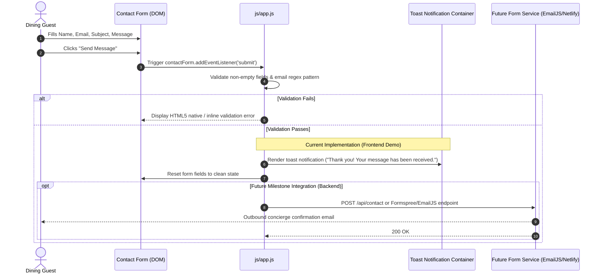

# Information Architecture & User Flow Specification: Reusable Restaurant Website Product

> **Document Version**: 1.0.0  
> **Lifecycle Phase**: Milestone 1 — Product Design (M1.2)  
> **Source of Truth**: [`PRODUCT_SPECIFICATION.md`](file:///c:/Users/navee/OneDrive/Desktop/Website%20development/PRODUCT_SPECIFICATION.md)  
> **Target Audience**: Freelance Web Developers, Restaurant Clients, UX/UI Designers  

---

## 1. Structural Audit of Current Application

The existing website is architected as an optimized, semantic single-page application (SPA) with a dedicated edge-routed 404 error page. 

```
Root Domain / Base Route
├── index.html (Single-Page Multi-Section Master)
│   ├── #site-header (Sticky Glass Navigation Bar)
│   ├── #hero (Cinematic Atmosphere & Accolades)
│   ├── #about (Executive Chef Spotlight & Sourcing Philosophy)
│   ├── #menu (Dynamic Menu Catalog & Real-Time Filter Engine)
│   ├── #story / #experiences (Dining Sanctuaries & Spaces Showcase)
│   ├── #reservation (Table Reservation System & Digital Boarding Pass)
│   ├── #gallery (Visual Gastronomy Gallery & Lightbox Modal)
│   ├── #testimonials (Critical Press & Testimonial Carousel)
│   ├── #contact (Location, Service Status, Hours & Concierge Inquiry)
│   └── #footer (Brand Details, Operational Logistics, Legal Notices)
├── 404.html (Branded Standalone Not-Found Routing)
└── Global Overlays & Modals (DOM Appended)
    ├── #cart-drawer (Slide-Out Cart & 3-Step Checkout Simulation)
    ├── #gallery-lightbox (Full-Screen Keyboard-Accessible Modal)
    ├── #mobile-nav (Slide-In Mobile Navigation Drawer)
    ├── #sound-synth (Web Audio Synthesizer Controller)
    └── #toast-container (Ephemeral Feedback Notifications)
```

---

## 2. Information Architecture Hierarchy

```mermaid
graph TD
    Root["Client Website Root (/)"] --> Header["Sticky Header Navigation"]
    Root --> Hero["Hero Section (First Impression)"]
    Root --> About["About Section (Culinary Philosophy & Chef)"]
    Root --> Menu["Menu Section (Catalog, Dietary & Search)"]
    Root --> Spaces["Dining Sanctuaries (Spaces & Capacities)"]
    Root --> Reservation["Reservation Engine (Booking & Pass)"]
    Root --> Gallery["Visual Gallery (Ambiance & Lightbox)"]
    Root --> Reviews["Testimonials (Critic Press & Ratings)"]
    Root --> Contact["Contact & Hours (Service Clock & Inquiries)"]
    Root --> Footer["Footer (Logistics, Socials & Legal)"]

    Header --> CartDrawer["Off-Canvas Cart Drawer"]
    Header --> MobileNav["Mobile Drawer Menu"]
    Gallery --> Lightbox["Fullscreen Modal Lightbox"]
    Root --> 404Page["404 Standalone Page (/404.html)"]
```



### Section Breakdown & Purpose Matrix

| Section ID | Section Title | Primary Purpose | Main Content Elements | Primary User Action | Secondary User Actions |
| :--- | :--- | :--- | :--- | :--- | :--- |
| **`#site-header`** | Navigation Bar | Persistent orientation & quick access | Logo crest, anchor links, cart badge button, "Book a Table" CTA, hamburger trigger | Navigate to specific section | Open cart drawer; open mobile menu |
| **`#hero`** | Brand Hero | Immediate emotional prestige & credibility | Ambient visual background, brand headline, subtitle, Michelin/critic accolades ticker | Click "Explore Menu" (`#menu`) | Click "Reserve a Table" (`#reservation`) |
| **`#about`** | Heritage & Story | Establish culinary trust & philosophy | Chef portrait, executive chef quote, sourcing guarantees, artisanal heritage narrative | Read chef credentials | Scroll to menu |
| **`#menu`** | Menu Catalog | Product discovery & order staging | Category tabs (6 categories), dietary filters (*Vegan, GF*), search bar, 15 dish cards, wine pairings | Filter by category or search | Click "Add to Order" to stage dishes |
| **`#story` / `#experiences`** | Dining Sanctuaries | Showcase physical spaces & ambiance | 4 distinct hall cards (*Grand Dining Room, Wine Cellar, Chef's Table, Starlit Terrace*), capacities | Choose preferred dining room | Proceed to table booking |
| **`#reservation`** | Table Reservation | Capture booking intent & details | Guest counter (+/-), dining area cards, date picker, time slot pills, guest details inputs | Submit table reservation | Click "Book Another" (in-place reset) |
| **`#gallery`** | Visual Ambiance | Sensory proof of plating & decor | 6 high-resolution photography assets, category filters | Click photo to view enlarged in Lightbox | Navigate with `←` / `→` or press `Esc` |
| **`#testimonials`**| Critic Reviews | Social proof & third-party endorsement | 5-star rating cards, critic quotes, reviewer publications, avatar images, dot indicators | Read press reviews | Manually toggle review slide dots |
| **`#contact`** | Hours & Location | Practical logistics & custom inquiries | Real-time service status badge, weekly lunch/dinner schedule, address, map link, private event form | Submit event inquiry form | Click phone to call; click email |
| **`#footer`** | Global Footer | Final reassurance & compliance | Legal copyright, operational hours summary, social profile icons, custom 404 page link | Access social media profiles | Navigate to 404 test page |

---

## 3. Primary User Flow (The Dining Guest)

The primary journey represents a visitor transitioning from discovery to conversion:

```
[1. LANDING]
     │
     ▼
[2. DISCOVERY]
   • Absorbs dark cinematic luxury aesthetics
   • Observes Michelin / Sommelier accolades ticker
   • Evaluates brand positioning in under 5 seconds
     │
     ├───► [Path A: Immediate Booking] ──► Clicks "Reserve a Table" ──► Jumps to #reservation
     │
     ▼
[3. MENU EXPLORATION]
   • Clicks category tab (e.g., "Mains" or "Biryani")
   • Toggles dietary filter (e.g., "Vegan" or "Gluten-Free")
   • Searches specific ingredient (e.g., "Truffle")
   • Reads dish description, price, calorie badge, and sommelier wine pairing
     │
     ├───► [Path B: Takeout Ordering] ──► Clicks "Add to Order" ──► Off-Canvas Cart Drawer Opens
     │
     ▼
[4. AMBIANCE VALIDATION]
   • Reviews Executive Chef credentials & farm-to-table guarantees in #about
   • Inspects the 4 Dining Sanctuaries (Grand Room, Wine Cellar, etc.)
   • Clicks gallery photo to open fullscreen Lightbox modal
   • Reviews 5-star critic reviews in Testimonials carousel
     │
     ▼
[5. CONVERSION ACTION]
   • Selects date, time slot, dining space, and party size in #reservation
   • Fills in name, email, and phone number
   • Clicks "Confirm Table Reservation"
     │
     ▼
[6. CONFIRMATION & LOGISTICS]
   • Receives instant digital dining boarding pass (`RES-XXXXXX`)
   • Checks real-time service status badge in #contact ("Service In Session • Open Tonight")
   • Notes physical address and phone number
```

---

## 4. Reservation User Flow & Architectural Separation

```mermaid
sequenceDiagram
    autonumber
    actor Guest as Dining Guest
    participant UI as Reservation Form (DOM)
    participant Engine as js/reservation.js
    participant Storage as In-Memory State
    participant Backend as Future API (OpenTable/Postgres)

    Guest->>UI: Selects Date, Time Slot, Area & Guest Count (+/-)
    Guest->>UI: Inputs Name, Email, Phone, Special Request
    Guest->>UI: Clicks "Confirm Table Reservation"
    UI->>Engine: Trigger handleReservationSubmit(e)
    Engine->>Engine: Validate date is present & not in past
    Engine->>Engine: Validate name, email format, phone digits
    
    alt Validation Fails
        Engine-->>UI: Highlight invalid fields & display inline error
    else Validation Passes
        Note over Engine,Storage: Current Implementation (Frontend Demo)
        Engine->>Storage: Store booking object in memory
        Engine->>Engine: Generate random booking code `RES-XXXXXX`
        Engine-->>UI: Hide form inputs; render styled boarding pass with QR mockup
        Engine-->>Guest: Provide "Book Another Reservation" in-place reset button
        
        opt Future Milestone Integration (Backend)
            Engine->>Backend: POST /api/reservations (JSON payload)
            Backend-->>Engine: 201 Created (confirmed reservation ID)
            Backend->>Guest: Trigger SMS (Twilio) & Email (SendGrid) confirmation
        end
    end
```

### Architectural Classification
- **Current Frontend Implementation**: Fully interactive client-side form with input validation, stepper bounds (1–12 guests), dynamic area selection, time slot pill activation, instant boarding pass rendering, and in-place reset without page reload.
- **Backend Responsibility (Future M2+)**: Persisting reservation records to PostgreSQL/Supabase, verifying real-time table availability against dining room floorplans, and sending automated transactional SMS/email confirmations.

---

## 5. Contact & Private Dining User Flow



### Architectural Classification
- **Current Frontend Implementation**: Client-side field validation, regex email verification, form reset, and high-visibility ephemeral toast alert.
- **Backend Responsibility (Future M2+)**: Outbound SMTP email transmission to client inbox via Formspree, Netlify Forms, or SendGrid webhook.

---

## 6. Business Owner / Freelance Customization Flow

This flow maps how a freelance developer takes a real restaurant client's assets and produces a customized digital flagship:

```
[1. Client Intake & Asset Gathering]
   • Restaurant Name, Logo / Crest SVG, Brand Colors
   • 15 Menu Dishes (Names, Descriptions, Prices, Pairings, Calories)
   • 6 High-Res Ambiance / Food Photos
   • Operating Schedule (Lunch / Dinner Hours per day)
   • Contact Coordinates (Address, Phone, Email, Map Coordinates)
     │
     ▼
[2. Tier 1: Content Customization in `js/restaurant.config.js`]
   • Update RestaurantConfig.brand (name, tagline, phone, email, address)
   • Update RestaurantConfig.hours (schedule array & live status bounds)
   • Update RestaurantConfig.menuItems (dishes, prices, categories, tags)
   • Update RestaurantConfig.gallery (image URLs & captions)
   • Update RestaurantConfig.diningAreas (room names & capacities)
   • Update RestaurantConfig.testimonials (critic names & quotes)
     │
     ▼
[3. Tier 2: Theme / Design Customization in `css/design-system.css`]
   • Adjust `--color-accent` (e.g., Gold `#E5A93C`, Emerald `#10B981`, Ruby `#E11D48`)
   • Adjust `--font-display` & `--font-body` (Google Fonts imports in index.html)
     │
     ▼
[4. Tier 3: Production Validation & Build]
   • Run `npm test` -> confirms syntax and configuration parsing
   • Run `npm run build` -> confirms production readiness
     │
     ▼
[5. Deployment Hand-off]
   • Deploy via `npx surge . --domain <client-domain>.surge.sh` or Vercel/Netlify
   • Configure client's custom domain DNS CNAME & A records
```

---

## 7. Navigation Map

```mermaid
graph LR
    subgraph Header ["Primary Navigation (Header)"]
        NavBrand["Brand Crest / Logo (#)"]
        NavMenu["Menu (#menu)"]
        NavStory["Heritage / Story (#about)"]
        NavSpaces["Sanctuaries (#story)"]
        NavGallery["Gallery (#gallery)"]
        NavRes["Reservations (#reservation)"]
        NavContact["Contact (#contact)"]
        NavCart["Cart Drawer Trigger (#cart-btn)"]
        NavBookBtn["CTA: 'Book a Table' (#reservation)"]
    end

    subgraph Drawer ["Off-Canvas Modals"]
        Cart["Cart Drawer (#cart-drawer)"]
        MobileMenu["Mobile Drawer (#mobile-nav)"]
        Lightbox["Gallery Lightbox (#gallery-lightbox)"]
    end

    subgraph FooterNav ["Footer Navigation (Footer)"]
        FootMenu["Menu (#menu)"]
        FootStory["Our Story (#about)"]
        FootGallery["Gallery (#gallery)"]
        FootRes["Reservations (#reservation)"]
        FootHours["Hours & Location (#contact)"]
        Foot404["404 Experience (404.html)"]
        FootSocial["Instagram / Facebook / TripAdvisor"]
    end

    Header --> Drawer
    Header --> FooterNav
```



---

## 8. Responsive Information Architecture (Priority by Viewport)

| Section / Component | Desktop (1200px+) | Tablet (768px – 1024px) | Mobile (320px – 480px) |
| :--- | :--- | :--- | :--- |
| **Navigation** | Full horizontal link bar + Cart badge + "Book a Table" CTA button | Horizontal links preserved; CTA condensed | Collapsed into Hamburger icon; slide-in drawer with backdrop dismiss |
| **Hero** | Split typographic layout + Accolades horizontal ticker | Centered typographic layout; 3-column ticker | Vertical stacked CTAs (100% width); 2-column or wrapping ticker |
| **Menu Grid** | 3-column culinary card grid with hover zoom | 2-column card grid | **1-column full-width card layout** with horizontal swipe category tabs; **zero horizontal overflow** |
| **Cart Drawer** | 420px right-aligned slide-out sheet | 400px right-aligned slide-out sheet | Full-screen width (100vw) slide-out drawer with floating checkout bar |
| **Reservation** | Side-by-side: Area selection + Date/Time/Guest inputs | Stacked sections with full-width area cards | 1-column stepped flow; full-width touch-friendly time slot pills |
| **Gallery** | 3-column masonry grid | 2-column photo grid | 1-column high-resolution stacked photo cards |
| **Contact & Hours** | Side-by-side: Service hours table + Inquiry form | Stacked: Hours table above Inquiry form | Stacked; one-tap click-to-call phone button and directions link |

---

## 9. User-Flow Edge Cases & Handled Behavior

| Scenario / Edge Case | Trigger / Condition | Expected System Behavior | Implementation Status |
| :--- | :--- | :--- | :--- |
| **Missing Form Fields** | User clicks submit on reservation or contact form with blank fields | Prevents submission; native HTML5 `:invalid` styles apply; focuses first invalid input field | **Handled** |
| **Invalid Email Format** | User types invalid email (e.g. `user@`) | Regex validation triggers inline browser error: "Please include an '@' in the email address" | **Handled** |
| **Past Date Selection** | User attempts to pick yesterday's date in reservation calendar | Input `min` attribute dynamically set to today's date (`new Date().toISOString().split('T')[0]`) | **Handled** |
| **Empty Menu Search** | User searches for a term not matching any dish or ingredient | Menu grid clears and displays a helpful empty state: *"No culinary dishes match your search. Try another filter."* | **Handled** |
| **Cart with Zero Items** | User opens cart drawer when no items have been added | Displays empty state illustration with message *"Your dining cart is empty"* and a direct *"Explore Menu"* link | **Handled** |
| **Invalid Promo Code** | User enters invalid promotional voucher in cart drawer | Input borders highlight red and feedback text displays: *"Invalid promotional code"*; totals unchanged | **Handled** |
| **Broken Image URL** | CDN image fails to load or returns HTTP 404 | Native `onerror` handler falls back to a graceful placeholder gradient and descriptive alt text | **Handled** |
| **Invalid URL Route** | User types an invalid path (e.g. `/unknown-page`) | Surge/edge CDN routes request to branded `404.html` with button returning to homepage | **Handled** |
| **Excessive Guest Party** | User attempts to increment guest counter beyond 12 guests | Stepper `+` button disables; alert advises contacting restaurant concierge directly for parties > 12 | **Handled** |
| **Multiple Reservations** | User finishes a booking pass and wants to make another reservation | Boarding pass provides a dedicated *"Book Another Reservation"* button that resets DOM form state in-place | **Handled** |

---

## 10. Architectural Validation: Current Implementation vs. M1.2 Design

| Area | Current Implementation | M1.2 Architecture Design | Gap Analysis |
| :--- | :--- | :--- | :--- |
| **Routing Model** | Single-page HTML5 with `#anchor` scrolling + `/404.html` | Preserves SPA architecture for zero-latency hosting | **0 Gap** (Fully aligned) |
| **Navigation** | Sticky glassmorphic navbar with collapse, cart badge, mobile drawer | Formalized hierarchy of primary, secondary, and drawer states | **0 Gap** (Fully aligned) |
| **Menu System** | Dynamic 15 dishes, 6 categories, dietary pills, search debounce | Formalized catalog structure and empty search state definition | **0 Gap** (Fully aligned) |
| **Cart & Ordering** | Off-canvas drawer with line items, promo code, 3-step checkout | Documented as frontend demo order staging flow | **0 Gap** (Fully aligned) |
| **Reservation Engine** | Stepper, area cards, time pills, digital pass generation, reset button | Documented as frontend guest pass generator | **0 Gap** (Fully aligned) |
| **Gallery & Lightbox** | 6 images, modal lightbox, keyboard navigation (`←`, `→`, `Esc`) | Formalized modal overlay architecture | **0 Gap** (Fully aligned) |
| **Contact & Hours** | Service clock badge, weekly hours table, validated inquiry form | Formalized logistics hierarchy and toast notification feedback | **0 Gap** (Fully aligned) |
| **Customization Model** | Centralized `restaurant.config.js` and `design-system.css` | Formalized 3-tier customization model (Content, Design, Backend) | **0 Gap** (Fully aligned) |
| **Backend Integrations** | Simulated client-side boarding passes & order tickets | Defined future roadmap API contracts for Stripe/OpenTable | **Documented Boundary** (No code change required in M1) |
